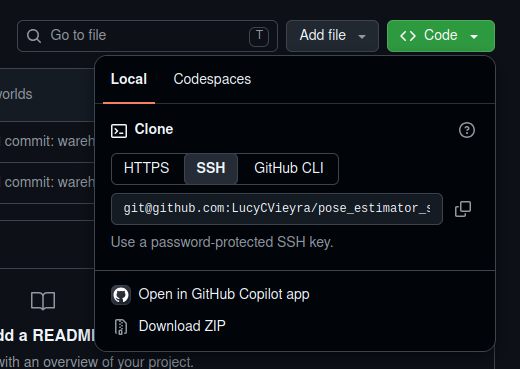

# pose_estimator_sim

Gazebo simulation worlds for testing drone pose estimation with a **PX4 x500** quadcopter, bridged to **ROS 2 Humble**.

The repo contains two worlds and a custom x500 model that carries two cameras and a 2D lidar:

| World | File | Description |
|-------|------|-------------|
| `cats` | `cats_world/cats_world.sdf` | Indoor room with textured walls, obstacles, window tunnels and a take-off / landing platform. |
| `cats_no_collision` | `cats_world/cats_no_collision.sdf` | Same room, but the obstacles and tunnels have no collisions (the drone can fly through them). |
| `world_demo` | `tugbot_depot/tugbot_depot.sdf` | Warehouse (Depot model downloaded from Gazebo Fuel on first run, needs internet). |

## Repository layout

```
pose_estimator_sim/
├── cats_world/
│   ├── cats_world.sdf          # Main indoor world
│   ├── cats_no_collision.sdf   # Same world without obstacle collisions
│   ├── meshes/                 # .glb models used by the world (walls, furniture, floor…)
│   ├── materials/              # Textures
│   ├── images/                 # Landing platform and ArUco marker images
│   ├── x500/                   # Custom x500 drone model (spawns at 0, 0)
│   └── *.blend                 # Blender sources of the meshes
└── tugbot_depot/
    ├── tugbot_depot.sdf        # Warehouse world
    └── x500/                   # Custom x500 drone model (spawns at 2.75, 1.0)
```

### Drone sensors

The custom `x500/model.sdf` adds these sensors on top of the stock PX4 model:

| Sensor | Gazebo topic |
|--------|--------------|
| Pi camera | `/pi_camera/image_raw`, `/pi_camera/camera_info` |
| Camera | `/camera/image_raw`, `/camera/camera_info` |
| 2D lidar | `/scan` |

The two `x500` folders are identical except for the drone's initial pose.

## Prerequisites

Tested with Ubuntu 22.04, ROS 2 Humble, PX4 v1.14.3 and Gazebo Garden.

1. **ROS 2 Humble**: follow the [ROS 2 installation steps](https://docs.ros.org/en/humble/Installation/Ubuntu-Install-Debs.html), then source it in every new terminal:

    ```sh
    echo "source /opt/ros/humble/setup.bash" >> ~/.bashrc
    source ~/.bashrc
    ```

2. **PX4 SITL and Gazebo**:

    ```sh
    cd ~
    git clone https://github.com/PX4/PX4-Autopilot.git --recursive --branch v1.14.3
    bash ./PX4-Autopilot/Tools/setup/ubuntu.sh
    cd PX4-Autopilot/
    make px4_sitl
    ```

    For more details see the [PX4 ROS 2 User Guide](https://docs.px4.io/main/en/ros2/user_guide.html#install-px4).

3. **Gazebo ↔ ROS 2 bridge**:

    ```sh
    sudo apt install ros-humble-ros-gzgarden
    ```

## Installation

### 1. Clone this repo (SSH)

The commands below assume the repo is cloned in your home folder (`~/pose_estimator_sim`).

**a. Check for an SSH key, or create one**

```sh
ls ~/.ssh/id_ed25519.pub
```

If it doesn't exist, create it (press Enter to accept the defaults):

```sh
ssh-keygen -t ed25519 -C "your_email@example.com"
```

**b. Add the key to GitHub**

```sh
cat ~/.ssh/id_ed25519.pub
```

Go to [github.com/settings/keys](https://github.com/settings/keys), click **New SSH key**, paste the key and save.

**c. Clone**

Copy the SSH URL from the **Code** button on GitHub:



```sh
cd ~
git clone git@github.com:USERNAME/pose_estimator_sim.git
```

### 2. Install the custom x500 model into PX4

PX4 spawns the drone from its own model folder, so the stock x500 (no cameras) has to be replaced by the one from this repo. Back up the original once:

```sh
cp -r ~/PX4-Autopilot/Tools/simulation/gz/models/x500 ~/PX4-Autopilot/Tools/simulation/gz/models/x500_original
```

Then copy the model that matches the world you are going to run:

```sh
# For cats / cats_no_collision
cp ~/pose_estimator_sim/cats_world/x500/model.sdf ~/PX4-Autopilot/Tools/simulation/gz/models/x500/model.sdf

# For tugbot_depot
cp ~/pose_estimator_sim/tugbot_depot/x500/model.sdf ~/PX4-Autopilot/Tools/simulation/gz/models/x500/model.sdf
```

## How to run

Open **4 terminals**. Start them in order and wait for each to be ready before the next.

**Terminal 1: start Gazebo with a world**

```sh
# cats world
cd ~/pose_estimator_sim/cats_world
gz sim cats_world.sdf -r        # or: gz sim cats_no_collision.sdf -r
```

```sh
# tugbot depot (warehouse)
cd ~/pose_estimator_sim/tugbot_depot
gz sim tugbot_depot.sdf -r
```

**Terminal 2: start PX4 SITL and spawn the drone**

```sh
cd ~/PX4-Autopilot
HEADLESS=1 make px4_sitl gz_x500
```

PX4 attaches to the Gazebo instance that is already running. When you see `Ready for takeoff!`, the drone appears in the Gazebo world.

**Terminal 3: bridge the camera topics to ROS 2**

```sh
ros2 run ros_gz_bridge parameter_bridge \
  /pi_camera/image_raw@sensor_msgs/msg/Image[ignition.msgs.Image \
  /pi_camera/camera_info@sensor_msgs/msg/CameraInfo[ignition.msgs.CameraInfo \
  /camera/image_raw@sensor_msgs/msg/Image[ignition.msgs.Image \
  /camera/camera_info@sensor_msgs/msg/CameraInfo[ignition.msgs.CameraInfo
```

To also bridge the lidar, add: `/scan@sensor_msgs/msg/LaserScan[ignition.msgs.LaserScan`

**Terminal 4: check the data in ROS 2**

```sh
ros2 topic list                       # should include /camera/image_raw, /pi_camera/image_raw…
ros2 topic hz /camera/image_raw
ros2 run rqt_image_view rqt_image_view
```

This terminal is also where you run your pose estimator node.

## Troubleshooting

- 
- **Restoring the stock drone**:

    ```sh
    cp -r ~/PX4-Autopilot/Tools/simulation/gz/models/x500_original/. ~/PX4-Autopilot/Tools/simulation/gz/models/x500/
    ```
